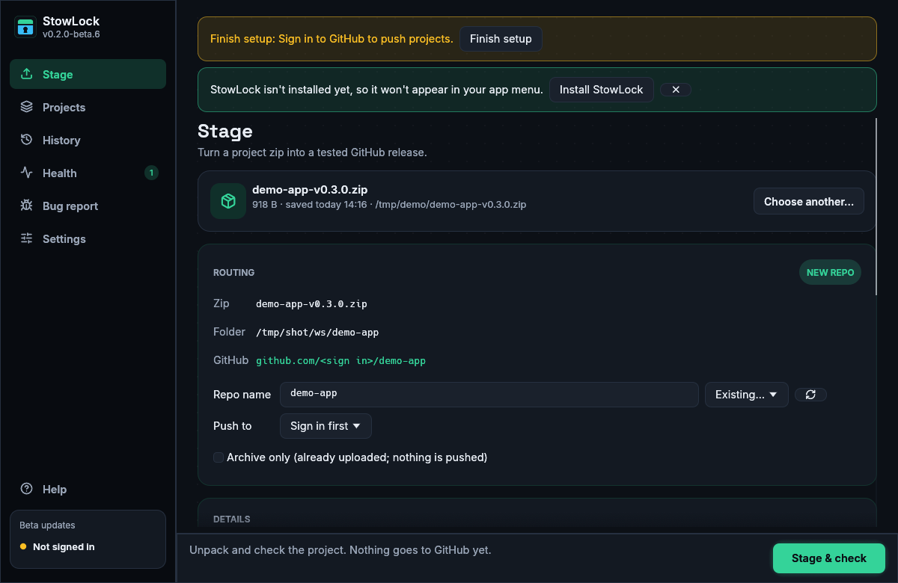
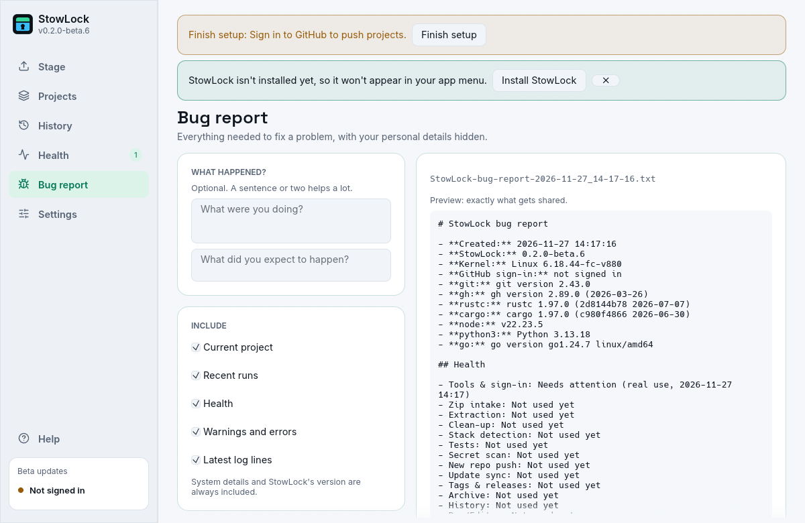

<p align="center"></p>

<h1 align="center">StowLock</h1>

<p align="center"><b>Drop in a project zip, get a clean, tested GitHub repo, with old versions neatly archived.</b></p>

**Install** (one line, no password, updates itself afterwards):

```bash
curl -fsSL https://raw.githubusercontent.com/Matt-B-007/StowLock/main/install.sh | sh
```

<!-- AUR: once stowlock-beta-bin is published, add: or `paru -S stowlock-beta-bin` -->

StowLock is a small native Linux app (Rust + egui) for people who build projects with AI tools and get them back as zip files. Instead of a Downloads folder full of `project-final-v2 (3).zip` and git commands typed by hand, StowLock puts each project in its own folder, checks it, lets you try it, pushes it to the right GitHub repo (new or existing) and files the zip away.

Built for CachyOS and other Arch-based distributions; it runs on any x86_64 Linux desktop.

<p align="center"></p>

## What it does

- **Routes every zip to the right repo.** `sluice-v2.zip` updates your existing `sluice` repo instead of creating `sluice-v2`. The full target (`zip → folder → github.com/you/repo`) is shown before anything happens.
- **Three modes:** **New repo**, **Update** (syncs files into the existing repo, removes deleted files, keeps history) and **Archive only** (files an old zip without pushing).
- **Safe extraction.** Zip paths that try to escape the folder, symlinks and zip bombs are refused. A single wrapper folder (`myapp-main/`) is unwrapped.
- **Clean repos.** Removes OS junk, `node_modules`, `target`, virtualenvs and nested `.git` folders; writes a `.gitignore`; adds a starter README and an optional license for new repos. `.env` files are never deleted and never committed.
- **Checks before push that match GitHub's.** If the project has GitHub workflows, StowLock runs their steps here with the same commands and settings (Python packages go into StowLock's own environment for the project, never system-wide), and lists the steps only GitHub can run. A step that needs something missing from your computer is marked "Can't run here" with how to install it, instead of failing, and the other steps still run. Projects with `scripts/check.sh` (exit 3 = tools missing) are understood. Tools a workflow installs with pip or Cargo are installed in StowLock's own folders, never system-wide. If GitHub's build fails, **Re-run on GitHub** is one click. Otherwise it runs the project's tests (Rust, Node, Python, Go). It also scans for leaked keys and tokens. Optional exact mode runs the workflows with `act` (needs Docker). Failing checks block the push unless you explicitly override (secret hits can't be overridden on a public repo).
- **Try it first.** Run the staged project in a terminal, fix it in your editor, re-check, then push exactly what's in the folder.
- **Stable or beta releases.** The version is read from the zip; StowLock shows the latest on GitHub, suggests the next fix or feature, and warns when a version would count as older than one already released. Betas are marked as pre-releases.
- **Watches GitHub's build after every push.** If it fails, StowLock shows the failing step, opens the log, copies it for an AI, or deletes the release and tag so the version can be reused.
- **Keeps Downloads empty.** After a successful push the zip moves to `~/GitHub_Projects/_archive/<project>/`.
- **Never force-pushes**, never overwrites unsaved local work, and stops if GitHub has changes you don't.
- **If a check fails, nothing is lost.** Load a fixed zip and the failed attempt is set aside (a git stash, or a folder for a new repo). **Projects → Saved earlier attempts** lists them with Restore and Delete.
- **Sidebar screens:** Stage, Projects, History, Health, Bug report and Settings, in a light or dark theme that follows your desktop.
- A **History** of every push, a **Health** view and a built-in **self-test**.
- **No terminal needed:** installs git and GitHub's `gh` tool through your desktop's password dialog and signs you in with a one-time code in your browser.

## Install

### One command (easiest)

Open a terminal and paste:

```bash
curl -fsSL https://raw.githubusercontent.com/Matt-B-007/StowLock/main/install.sh | sh
```

It downloads the newest release, checks it against its published checksum (and its signature, if `minisign` is installed), installs it for your user (no password) and opens it. StowLock then appears in your app menu and updates itself from **Settings → Updates**. Run the same command again any time to reinstall.

Options go after `sh -s --`, for example `… | sh -s -- --stable --no-launch`:

| Option | What it does |
|---|---|
| `--beta` | The newest release, betas included (the default while StowLock is in beta) |
| `--stable` | The newest full release only |
| `--version X` | A specific version, for example `--version 0.1.0-beta.11` |
| `--uninstall` | Remove StowLock (keeps your settings, history and projects) |
| `--no-launch` | Don't open StowLock afterwards |
| `--from-source` | Build it from the source code (needs git and Rust) |

### From the AUR (CachyOS, Arch)

```bash
paru -S stowlock-beta-bin     # betas, while StowLock is in beta
paru -S stowlock-bin          # full releases, once 0.1.0 is out
```

(`yay` works the same way.) Updates then come with your normal system updates, and `sudo pacman -R stowlock-beta-bin` removes it.

### Download

1. Download `stowlock-linux-x86_64` from the [latest release](https://github.com/Matt-B-007/StowLock/releases).
2. Make it executable and install it:

   ```bash
   chmod +x stowlock-linux-x86_64
   ./stowlock-linux-x86_64 --install
   ```

StowLock now appears in your app menu, and "Open with StowLock" works on zip files. The installer says which version it installed and which it replaced, and warns you if your browser renamed the download (for example `stowlock-linux-x86_64(1)`).

### Build from source

```bash
sudo pacman -S --needed rust git github-cli
git clone https://github.com/Matt-B-007/StowLock.git
cd StowLock
cargo build --release
./target/release/stowlock --install
```

## Updates

- **Settings → Update channel:** **Stable** offers only full releases; **Beta** also offers betas. If you're running a beta, it starts on Beta. It never offers an older version.
- The update notice shows **What's new** and an **Update** button. StowLock downloads the new version and installs it only if its checksum matches **and** the checksum list carries a valid signature from StowLock's signing key (minisign; the public keys are in `packaging/minisign/` and built into the app). A release without a valid signature is treated as not available yet. Then it swaps the new version in and restarts. No GitHub sign-in is needed for updates.
- From a terminal: `stowlock --update`.
- Before a new version replaces the current one, it must pass a quick start-up check (`stowlock --self-test --quick`); if it doesn't, nothing changes.
- **Going back:** the version you had before an update is kept. Use **Settings → Go back to …**, or run `stowlock --rollback` if the window won't open. If a new version crashes, StowLock offers to go back the next time it starts.
- If you open a newer copy while an older one is running, StowLock asks whether to switch.

## First run

StowLock opens on the **GitHub account** panel:

1. **Install missing tools** (git and GitHub's `gh`), if needed. You'll see your desktop's normal password dialog.
2. **Sign in with GitHub.** StowLock shows a one-time code (already copied) and opens GitHub in your browser. Paste it and approve.
3. **Name and email for commits.** Optionally use GitHub's private email so your real address isn't on your commits.

Then choose a zip, click **Stage & check**, try it, and click **Push to GitHub**.

## Where things live

| Path | What |
| --- | --- |
| `~/GitHub_Projects/<project>/` | Your projects, one git repo each (configurable) |
| `~/GitHub_Projects/_archive/<project>/` | Uploaded and archived zips |
| `~/.config/stowlock/config.toml` | Settings |
| `~/.local/state/stowlock/` | Push history, logs, bug and self-test reports |
| `~/.cache/stowlock/` | Update downloads and the self-test sandbox |

StowLock never writes its own files into a project folder.

## Privacy

- Nothing leaves your computer except what you push to GitHub, the sign-in, your repo list and a release check against this repository (no personal data). No tracking, analytics or automatic crash uploads.
- If your computer's DNS doesn't answer during an update check, StowLock asks a DNS-over-HTTPS service (Cloudflare's 1.1.1.1, then Google's 8.8.8.8) for GitHub's address. Only the host name is sent, nothing about you or your projects.
- Once a day it asks `rustup check` whether a newer Rust is out (turn it off in Settings → Updates).
- StowLock never reads, stores or logs your GitHub token; sign-in is handled by `gh`.
- Its folders are readable only by your account. Secrets are blanked out the moment they're written to the log, and logs and reports are deleted after 30 days.
- Bug reports replace your username, GitHub account, organisations, repo and project names, emails, computer name, IP and MAC addresses and folder paths with placeholders, wherever they appear. Your project's file names and its own test output are left out (only pass/fail lines and failure messages stay).
- Your note in **What happened?** is hidden the same way, and **Also hide these words** adds your own words (a client's name, say) to every future report.
- Nothing is ever sent automatically. You see exactly what will be shared before you copy, save or download it, and saved reports are readable only by your account.

<p align="center"></p>

## Self-test

```bash
stowlock --self-test            # checks in a sandbox; never touches your projects or GitHub
stowlock --self-test --online   # also read-only checks of your GitHub sign-in
```

The same test runs from **Health → Run self-test**. Failures come with a ready-to-paste "AI fix prompt".

## Uninstall

```bash
stowlock --uninstall                # app only: keeps settings, history and projects
stowlock --uninstall --purge        # also settings, history, logs and reports
stowlock --uninstall --everything   # also your projects folder and archived zips (to the Trash; type DELETE)
stowlock --uninstall --dry-run      # show what would be removed
```

The same three choices are in **Settings → Uninstall StowLock**. Your repos on GitHub, git, gh and your GitHub sign-in are never touched.

## Development

```bash
cargo test       # unit and end-to-end tests (against a fake GitHub made of local bare repos)
cargo run        # start the app
```

CI runs the tests twice: on Ubuntu, and on an up-to-date Arch Linux with git's strictest settings, so problems with new versions of git and Rust show up before a release.

Pushing a `v*` tag builds `stowlock-linux-x86_64` and its checksum in GitHub Actions, attaches them to the release with the AUR files (`aur-PKGBUILD`, `aur-SRCINFO`), and publishes the AUR package once the `AUR_SSH_PRIVATE_KEY` secret is set in the repository.

## License

StowLock is free software, licensed under the [GNU General Public License v3.0 or later](LICENSE). It bundles the [Inter](https://rsms.me/inter/) font (SIL Open Font License 1.1) and [Lucide](https://lucide.dev) icons (ISC License); their licenses are in `assets/licenses/`.
